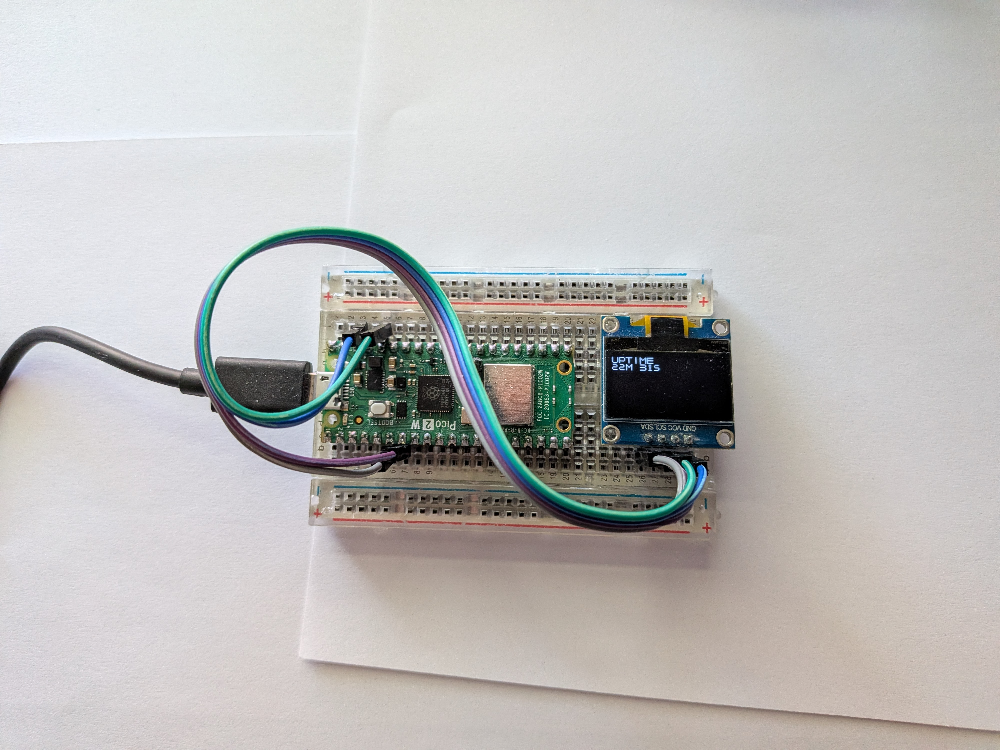

# SSD1306 Pico Demo

This is a demo project of doing test driven development (TDD)
on a Raspberry Pi Pico boards with Pico C/C++ SDK and CppUTest harness.

The [UptimePresenter](src/UptimePresenter.c) is responsible for formatting
the display data, including convertion of ASCII characteers into a display
[font](src/include/ssd1306_font.h) (not something a driver should be doing :P).





## I2C Pinout and BaudRate

see [App.h](src/include/App.h)


## Building and Uploading

- building the project for Pico 2W and uploading it to the board.

  ```shell
  git clone https://github.com/vladstechblog/ssd1306_pico_demo.git
  cd ssd1306_pico_demo
  cmake -B build_p2w -DPICO_PLATFORM=rp2350 -DPICO_BOARD=pico2_2
  cmake --build build_p2w
  picotool erase && picotool load -x build_p2w/src/demo.uf2
  ```


## Building and Running Host Build Tests

- component tests

  ```shell
  git clone https://github.com/vladstechblog/ssd1306_pico_demo.git
  cd ssd1306_pico_demo
  cmake -B build_host -DPICO_PLATFORM=host
  cmake --build build_host -t componentTestRunner
  ./build_host/test/componentTestRunner
  ```

- integration test

  ```shell
  git clone https://github.com/vladstechblog/ssd1306_pico_demo.git
  cd ssd1306_pico_demo
  cmake -B build_host -DPICO_PLATFORM=host
  cmake --build build_host -t integrationTestRunner
  ./build_host/test/integrationTestRunner
  ```
